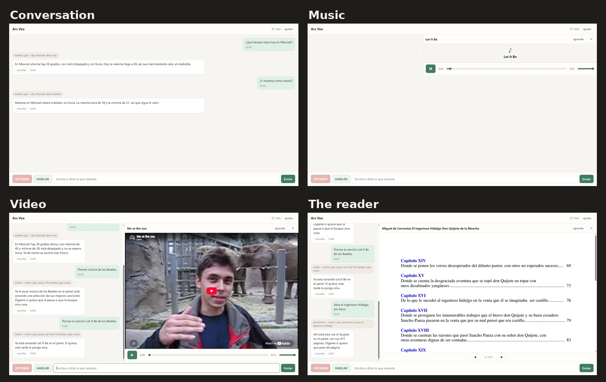
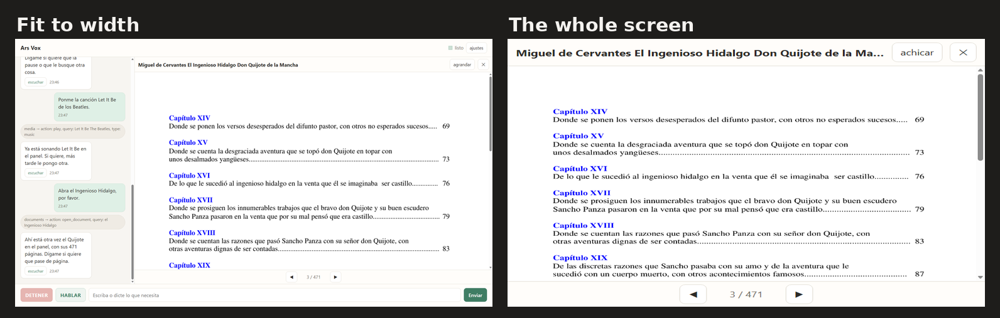
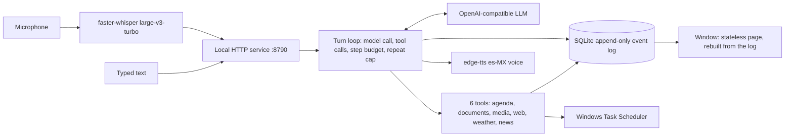

# Ars-Vox

**A voice-first desktop assistant in Mexican Spanish, built for one elderly user:
local Whisper speech recognition, a tool-calling LLM agent written from scratch
over an append-only event log, and reminders that ring even when the app is
closed.**

Talk or type; it answers out loud, and everything it does stays visible in one
window: the conversation on the left, a panel on the right for music, video and
documents. The user is addressed as *usted*, in plain words, and is never shown
an error they cannot act on.



## What it does

- **Speaks and listens.** Push-to-talk or typed text. Speech is recognised
  locally with faster-whisper (large-v3-turbo on CUDA) and answers are spoken
  with a neural es-MX voice.
- **Reminders that ring.** "Recuérdame tomar la pastilla a las ocho" becomes a
  Windows Task Scheduler task, so it fires on time with the app closed. Daily
  and weekly repeats are supported.
- **A simple task list.** Add, list and complete.
- **The web, on request.** Search (DuckDuckGo lite, with Mojeek as a fallback),
  page reading, weather (open-meteo) and news headlines (RSS), all keyless.
- **Music and video in the panel.** Options are read aloud with numbers and
  durations; the chosen one plays in the panel. When a video refuses to embed,
  the assistant offers the audio instead of showing an error.
- **Documents and books as pages.** It finds the user's own files under
  Documents, Desktop and Downloads; PDFs show as their real pages, text as
  page-sized pieces. Public-domain books that are not on disk can be fetched
  from Project Gutenberg.



## How it is built

The agent loop is about 200 lines of plain Python with raw HTTP to any
OpenAI-compatible endpoint, no agent framework. Its shape follows the harness
anatomy in [arXiv 2609.00006](https://arxiv.org/abs/2609.00006) (a source-code
study of eleven coding-agent runtimes), applied to a consumer product.



Design decisions worth a look:

- **The event log is the only truth.** Every user line, tool call, tool result
  and answer is appended to one SQLite table. The model's message history is a
  projection of that log through a single rule (`services/arsvox/store.py`), so
  history cannot drift from what happened, and a restart resumes the
  conversation by replaying it.
- **The window holds no state.** It asks the service for every event after an
  id and renders it, which is also how it recovers: kill the window mid-turn,
  the service finishes the turn alone, and the reopened window rebuilds from the
  log without replaying anything twice.
- **Prompt-cache hygiene.** The volatile context (time, counts of reminders and
  tasks) is appended as a snapshot event only when its text changes, so the
  prompt prefix stays stable between turns (`runtime.py`, `context.py`).
- **Few tools, wide actions.** Eighteen tool entries were collapsed into a
  handful (six today): four action families plus weather and news. Each family's `action` enum is
  built from its handler map, and arguments are checked against the tool's own
  JSON schema, so a bad argument comes back to the model as a sentence it can
  act on (`tools.py`).
- **Cheap caps instead of a permission engine.** A per-turn step budget and a
  repeated-identical-call cap (`limits.py`). A permission layer was written and
  then removed: one user, one machine, tools that write to a local database.
- **Failures that say why.** Web lookups distinguish "nothing found" from
  "blocked" and "no network", and the media path turns an embed refusal into an
  offer, so the assistant never claims something that did not happen.
- **One register, guarded by tests.** The persona speaks *de usted* in Mexican
  Spanish; `tests/test_register.py` fails if user-facing copy slips into
  Rioplatense *vos* forms.

| Path | What it is |
|---|---|
| `services/arsvox/runtime.py` | The turn loop |
| `services/arsvox/store.py` | Event log, projection, reminders, tasks |
| `services/arsvox/model.py` | OpenAI-compatible client with usage and prefix-cache accounting |
| `services/arsvox/tools.py` | Tool families, schemas and argument checks |
| `services/arsvox/voice.py`, `mic.py`, `tts.py` | Speech in and out |
| `services/arsvox/scheduler.py` | Reminders as Windows scheduled tasks |
| `services/arsvox/api.py` | Stdlib HTTP service that serves the window and the API |
| `apps/desktop/` | The window: plain HTML, CSS and JS, plus an optional Electron shell |
| `apps/cli/arsvox_cli.py` | Headless driver: `ask`, `chat`, `talk`, `transcribe`, `serve`, ... |
| `tools/` | Speech benchmarks, gate-session runners, UI capture scripts |

## Measured during development

These numbers come from the development log in this repo's commit history (the
working notes were later moved out of the tree). They were measured on one
laptop, so read them as evidence for the design, not as benchmarks.

| What | Result | Commit |
|---|---|---|
| Speech recognition speed, large-v3-turbo float16 on CUDA | real-time factor 0.07, about 6x faster than CPU | `370f394` |
| Speech recognition, 30 scripted requests from the target speaker | 22 of 30 understood; 4 of the misses were cut off by a fixed 6 s recording window, which led to the silence-terminated recorder | `5b24c92` |
| Prompt prefix cache | 84% of prompt tokens cached on the first turn, 88% to 94% on the following ones | `121f02d` |
| Turn latency (speech in to answer) | 2.8 to 5.1 s per turn, of which recognition 0.62 to 0.73 s | `121f02d` |
| Tool routing after the tool collapse | 11 of 11 real-model calls routed to the right family and action | `edcad37` |
| Tests | 149 pass with the full requirements installed | this branch |

## Run

Python 3.12. The product targets Windows (reminders use Task Scheduler); the
loop, tools and tests also run on Linux.

```bash
pip install -r requirements.txt
export ARSVOX_API_KEY=...                   # any OpenAI-compatible provider
export ARSVOX_BASE_URL=https://.../v1       # and its model in ARSVOX_MODEL
python -m apps.cli.arsvox_cli serve         # http://127.0.0.1:8790/
```

Open `http://127.0.0.1:8790/`, or `msedge --app=http://127.0.0.1:8790/` for a
window without browser chrome. On Windows, `tools\windows\run_service.ps1`
starts the service with the CUDA libraries on `PATH`. The key can also live in
`%USERPROFILE%\.arsvox\env` as `KEY=VALUE` lines; it is never read from the
repo tree unless you put a `.env` there yourself.

Headless, without the window:

```bash
python -m apps.cli.arsvox_cli ask "ponme un video de los Beatles" --speak
python -m apps.cli.arsvox_cli talk           # voice in, voice out
python -m apps.cli.arsvox_cli transcribe clip.m4a
pytest                                       # no model, microphone or network needed
```

## Limitations

- Built and tested for one person on one Windows laptop. It is not packaged:
  there is no installer, and the Electron shell expects a `.venv-win` virtual
  environment next to the repo.
- Needs a cloud LLM. The default endpoint and model are in
  `services/arsvox/config.py`; any OpenAI-compatible endpoint works.
- The voice (edge-tts) needs network. An offline voice is still an open item.
- Spanish only (Mexican Spanish by default, Rioplatense as an option).
- Messaging and reading books aloud are not built; books are shown, not
  narrated, on purpose for now.
- The 30-request voice gate was set at 24 of 30 and has not been declared
  passed.

The first prototype (an Electron and TypeScript app with a larger contract
layer) is kept on the `v1` branch.
